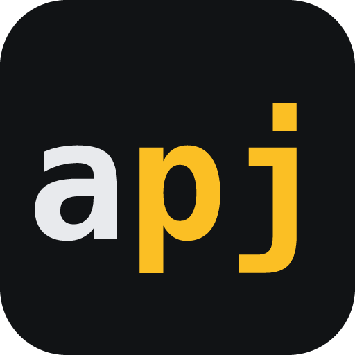

<p align="center"></p>

# apipj MCP server: Brazilian CNPJ lookup (API CNPJ)

Remote [Model Context Protocol](https://modelcontextprotocol.io) server for looking up and validating Brazilian companies by **CNPJ**, using the open data that Receita Federal publishes every month. Works in Claude, ChatGPT, Claude Code, Cursor, VS Code and any MCP client that supports Streamable HTTP.

```
https://apipj.com.br/mcp
```

This repository holds the public documentation and the [MCP Registry](https://registry.modelcontextprotocol.io) manifest ([`server.json`](server.json), name `br.com.apipj/cnpj`). The server itself is hosted by [apipj](https://apipj.com.br); there is nothing to install or run.

[](https://cursor.com/install-mcp?name=apipj&config=eyJ1cmwiOiJodHRwczovL2FwaXBqLmNvbS5ici9tY3AifQ==) [](https://vscode.dev/redirect/mcp/install?name=apipj&config=%7B%22type%22%3A%22http%22%2C%22url%22%3A%22https%3A%2F%2Fapipj.com.br%2Fmcp%22%7D)

## Tools

| Tool | What it does | Account |
|---|---|---|
| `consultar_cnpj` | Company record for a CNPJ: legal name, trade name, registration status and date, legal nature, size, share capital, opening date, full address with IBGE code, registered phone and e-mail, main and secondary activities (CNAE), Simples Nacional and MEI status, partners and administrators (QSA, CPF masked as published). Formats: `completo` (default) or `simplificado`. | Required |
| `validar_cnpj` | Checks format and check digits of a CNPJ, numeric or the new alphanumeric format (e.g. `12.ABC.345/01DE-35`). | Not required |
| `status_base` | Which monthly Receita Federal release is loaded, when it was generated and how many CNPJs it has. | Not required |
| `buscar_cnpjs` | Active companies by economic activity (CNAE) and/or municipality, paginated, without partner data. Available from 2026-10-28. | Required |

All tools are read-only (`readOnlyHint: true`, `destructiveHint: false`).

## Authentication

- **OAuth 2.1 (recommended):** clients that support MCP authorization (Claude, ChatGPT, Claude Code, Cursor, VS Code) open the apipj sign-in page the first time a tool needs an account. Sign in with Google (or e-mail and password) and click **Autorizar**. The server supports Client ID Metadata Documents and Dynamic Client Registration, with PKCE S256.
- **API key:** clients without OAuth can send `Authorization: Bearer apipj_live_...`. Create a free account and a key at [apipj.com.br/criar-conta](https://apipj.com.br/criar-conta).

Each lookup counts toward the per-minute limit and the monthly quota of your apipj account. See [plans](https://apipj.com.br/precos).

## Connect

**Claude (claude.ai, Desktop, mobile):** Customize → Connectors → *Add custom connector* → URL `https://apipj.com.br/mcp`. Leave the OAuth client fields empty.

**ChatGPT:** Settings → Apps & Connectors → enable Developer mode → *Add custom MCP server* → URL `https://apipj.com.br/mcp`, authentication OAuth.

**Claude Code:**

```bash
claude mcp add --transport http apipj https://apipj.com.br/mcp
```

**Cursor:** use the install button above, or the [apipj Cursor plugin](https://github.com/apipj/cursor-plugin), or add to `.cursor/mcp.json`:

```json
{ "mcpServers": { "apipj": { "url": "https://apipj.com.br/mcp" } } }
```

**VS Code:** use the install button above, or add to `.vscode/mcp.json`:

```json
{ "servers": { "apipj": { "type": "http", "url": "https://apipj.com.br/mcp" } } }
```

**Cline:** add the server to `cline_mcp_settings.json` as described in [llms-install.md](llms-install.md).

**Other clients (with an API key):**

```json
{
  "mcpServers": {
    "apipj": {
      "type": "http",
      "url": "https://apipj.com.br/mcp",
      "headers": { "Authorization": "Bearer YOUR_API_KEY" }
    }
  }
}
```

## Example prompts

- "What is the registration status and address of CNPJ 11.378.117/0001-20?"
- "Who are the partners of CNPJ 11.378.117/0001-20, and is it in Simples Nacional?"
- "Is the CNPJ 12.ABC.345/01DE-35 valid?"
- "Which month of Receita Federal data does apipj have loaded?"

## Data and limits

- Source: Receita Federal open data (CNPJ), loaded monthly. Data may be out of date and is not an official certificate.
- Partner CPF numbers are masked exactly as Receita Federal publishes them; the server never reveals full CPF numbers.
- Transport: Streamable HTTP, stateless, protocol versions 2025-11-25, 2025-06-18 and 2025-03-26.
- Server status: [apipj.com.br/status](https://apipj.com.br/status).

## Em português

Servidor MCP remoto do [apipj](https://apipj.com.br) para **consultar CNPJ** e **validar CNPJ** (inclusive o CNPJ alfanumérico) direto no Claude, no ChatGPT, no Cursor e em outros assistentes, com os dados abertos da Receita Federal (carga mensal). A consulta usa uma conta apipj: na primeira vez, o assistente pede para conectar; entre com o Google e clique em **Autorizar**. Validação e status funcionam sem conta. Guia completo: [apipj.com.br/guias/consultar-cnpj-ia-mcp](https://apipj.com.br/guias/consultar-cnpj-ia-mcp).

## Links

- Documentation: https://apipj.com.br/docs
- MCP guide: https://apipj.com.br/guias/consultar-cnpj-ia-mcp
- JavaScript/TypeScript client: [apipj/apipj-js](https://github.com/apipj/apipj-js) · Python client: [apipj/apipj-py](https://github.com/apipj/apipj-py) · n8n node: [apipj/n8n-nodes-apipj](https://github.com/apipj/n8n-nodes-apipj)
- Terms: https://apipj.com.br/termos · Privacy: https://apipj.com.br/privacidade
- Support: brunogalizzi@masterbi.com

Operated by MASTER BI TECNOLOGIA LTDA (CNPJ 35.659.589/0001-19). Documentation licensed under MIT.
